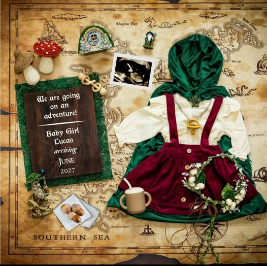

The day after we got our [first glimpse](/stories/first-glimpse/) of her, Jensen (aka Mom), shared the news on social media with this photo:

> We are going on an adventure! 
> Baby Girl Lucas, arriving June 2027.

The ultrasound print from the day before is tucked onto an old adventurer's map, next to a hooded green cloak and a little berry-red dress, all waiting for the little girl who will wear them.

